<div align="center">


# Spent

**Know where your money goes.**

A calm, private expense tracker for Android and the web, built with Flutter.
Track spending, income and recurring payments, and pull in payments from Google Pay, PhonePe and Paytm without linking a bank account.


</div>

<p align="center">
  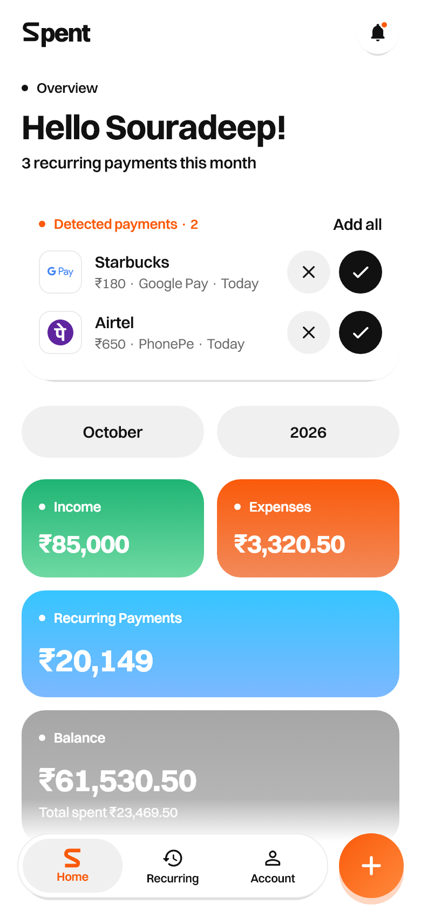
  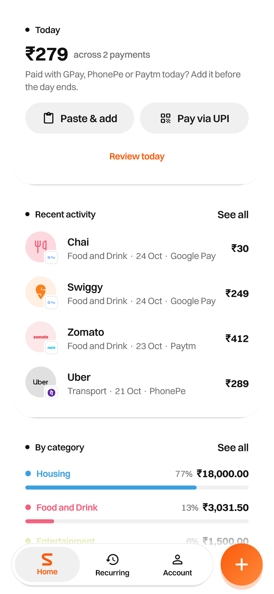
  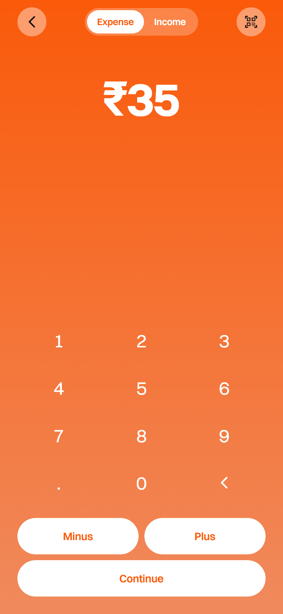
  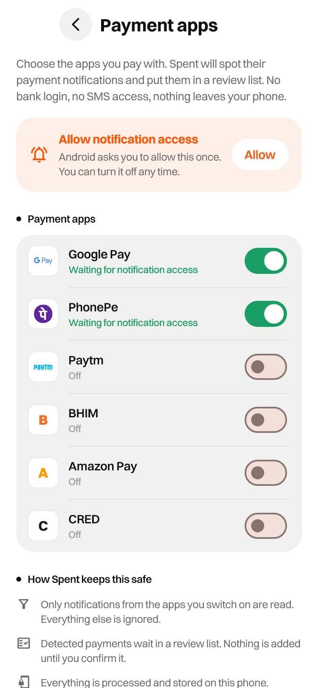
</p>

---

## Contents

- [Features](#features)
- [Payment apps: how auto-tracking works](#payment-apps-how-auto-tracking-works)
- [Privacy](#privacy)
- [Screenshots](#screenshots)
- [Getting started](#getting-started)
- [Project structure](#project-structure)
- [Testing](#testing)
- [Design](#design)
- [Limitations](#limitations)
- [Credits](#credits)

## Features

| | |
|---|---|
| **Overview** | Income, expenses, recurring payments and balance for any month, with a breakdown by category. |
| **Fast entry** | A calculator-style number pad (with **Plus / Minus** maths) for expenses *and* income, then category, date and "repeats monthly". |
| **Recurring payments** | Rent, subscriptions and salary repeat every month. You get a reminder 3 days before each one, and the Recurring tab counts down to the next charge. |
| **Payment apps** | Detects installed UPI apps (Google Pay, PhonePe, Paytm, BHIM, Amazon Pay, CRED) with their real icons. Switch on the ones you use and their payments are picked up automatically for review. |
| **Paste a message** | Paste any GPay, PhonePe or Paytm notification, or a bank debit/credit SMS. Spent reads the amount, payee, direction, date and app. |
| **Pay via UPI** | Start a payment in Spent. It opens the UPI app you choose with the details filled in, and logs the expense. |
| **Merchant logos** | Swiggy, Zomato, Uber, Netflix, Spotify, Airtel and more show their official logos. Every transaction carries a badge for the app it was paid with. |
| **Today** | An end-of-day card showing what went out today, with one tap to add anything you missed. |
| **Accounts** | Sign up and log in on the device. Each account keeps its own data, currency and connected apps. |
| **46 currencies** | A searchable currency picker. The suggestion is based on your device region (en-IN → ₹ INR). |
| **Sounds & haptics** | Quiet, designed feedback (a soft keypad tick, a marimba chime on save, a glass bell for new payments) that you can turn off. |

## Payment apps: how auto-tracking works

Spent never logs in to a bank or a UPI app. On Android it uses the system's **Notification access**, which only you can grant:

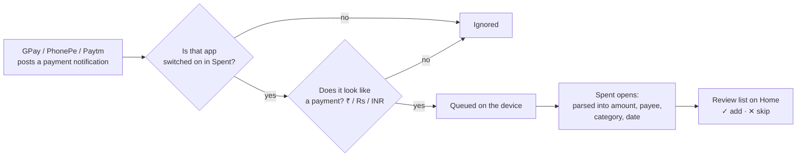

1. **Account → Payment apps.** Spent lists the payment apps installed on the phone, using their real icons.
2. **Switch on** the apps you pay with, then tap **Allow** to grant Notification access in Android settings.
3. New payments show up under **Detected payments** on Home. Nothing becomes a transaction until you confirm it.

The listener lives in [`SpentNotificationListener.kt`](android/app/src/main/kotlin/com/spent/spent/SpentNotificationListener.kt), and parsing happens in [`payment_parser.dart`](lib/payment_parser.dart).

## Privacy

- **On-device only.** Accounts, transactions and settings are stored locally (`shared_preferences`). Spent has no server and makes no network calls of its own.
- **Passwords** are stored as salted PBKDF2-HMAC-SHA256 hashes (20,000 iterations), never in plain text.
- **Notifications**: only apps you switch on are read. Anything that isn't a payment is dropped straight away, and the queue is capped and kept in private app storage.
- **No PINs, no bank logins, no SMS permission.** Spent never makes a payment on its own. Pay via UPI only hands the details to your UPI app, where you confirm as usual.
- Revoke access any time by switching an app off in Spent, or by removing Notification access in Android settings.

> Because accounts are local, there is no password reset and no sync between devices.

## Screenshots

<table>
  <tr>
    <td align="center">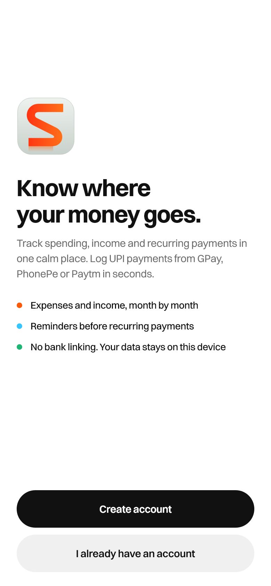<br/><sub>Welcome</sub></td>
    <td align="center">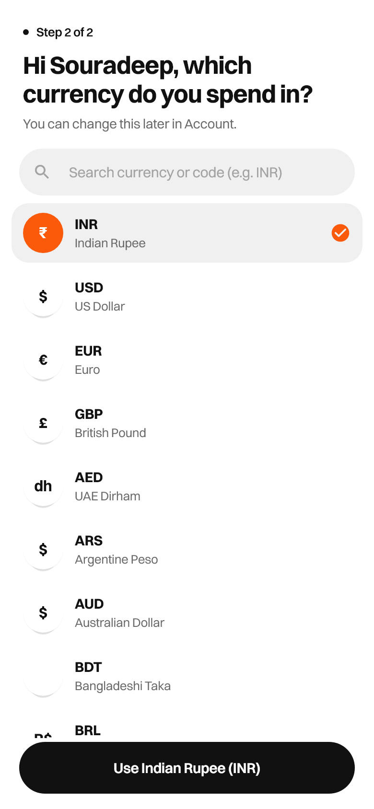<br/><sub>Pick a currency</sub></td>
    <td align="center">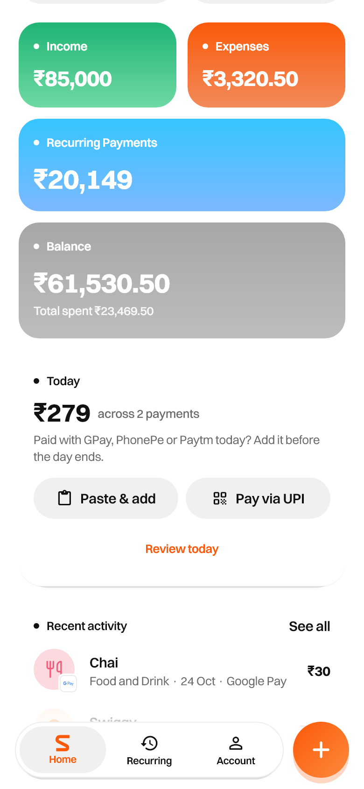<br/><sub>Monthly overview</sub></td>
    <td align="center">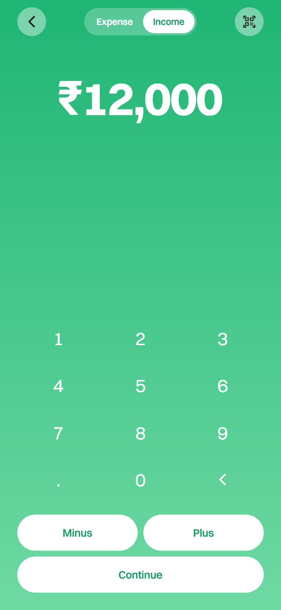<br/><sub>Add income</sub></td>
  </tr>
  <tr>
    <td align="center">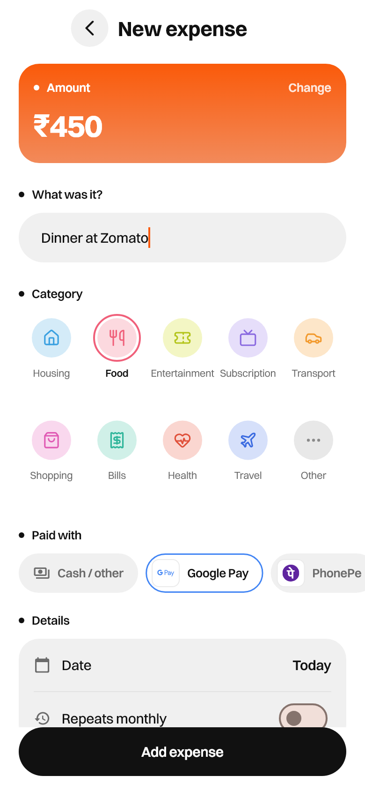<br/><sub>Category & paid with</sub></td>
    <td align="center">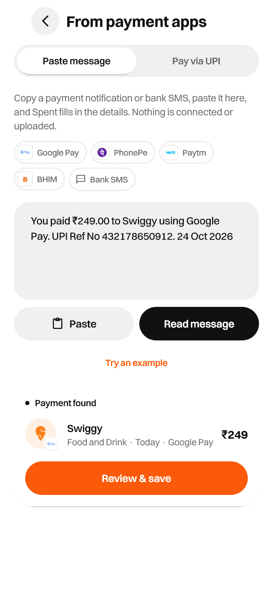<br/><sub>Paste a payment message</sub></td>
    <td align="center">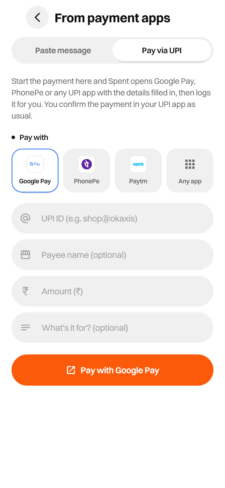<br/><sub>Pay via UPI</sub></td>
    <td align="center">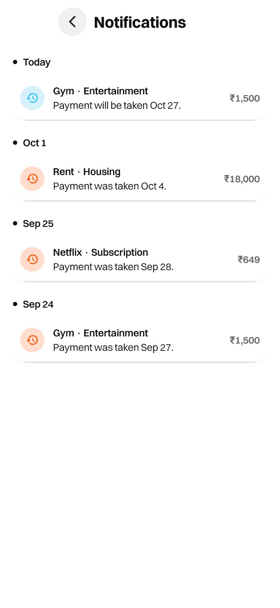<br/><sub>Reminders</sub></td>
  </tr>
  <tr>
    <td align="center">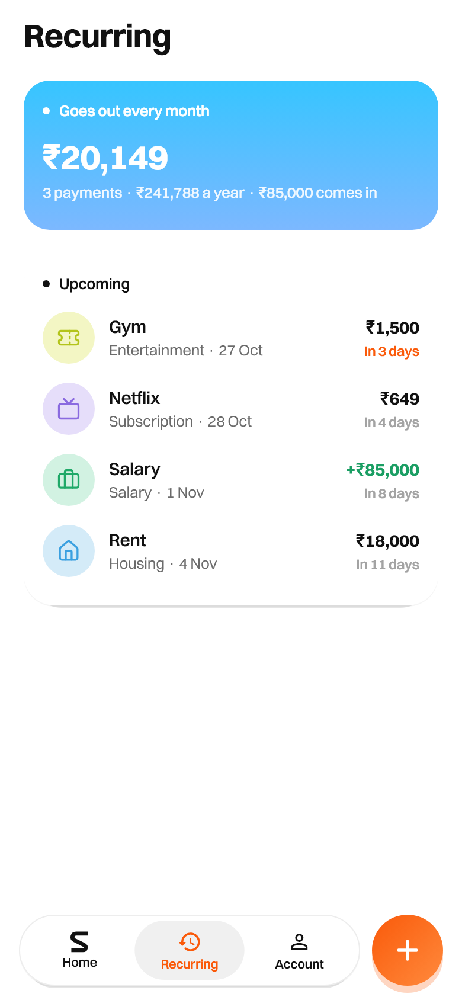<br/><sub>Recurring</sub></td>
    <td align="center">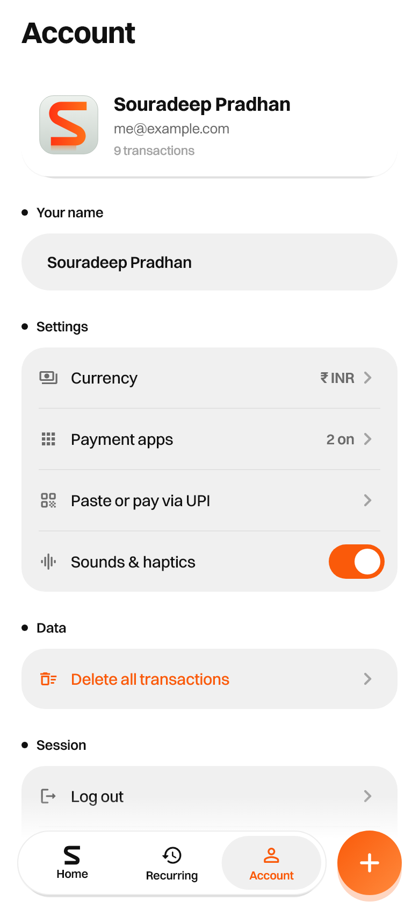<br/><sub>Account</sub></td>
    <td align="center"><br/><sub>Payment apps</sub></td>
    <td align="center"><br/><sub>Detected payments</sub></td>
  </tr>
</table>

## Getting started

### Install on Android

Download `app-release.apk` from the [latest release](https://github.com/pradhan-not-found/Spent/releases), open it on your phone and allow installing from your browser or file manager.

### Run from source

You'll need the [Flutter SDK](https://docs.flutter.dev/get-started/install) (stable, 3.47+). For Android builds you also need the Android SDK.

```bash
git clone https://github.com/pradhan-not-found/Spent.git
cd Spent
flutter pub get

flutter run -d chrome            # web, in a phone-sized frame on desktop
flutter run                      # a connected Android phone or emulator
```

### Build

```bash
flutter build apk --release      # build/app/outputs/flutter-apk/app-release.apk
flutter build web --release      # build/web
```

> The release APK is currently signed with the debug key so it installs on any device. Before publishing to the Play Store, set up your own [signing config](https://docs.flutter.dev/deployment/android#signing-the-app).

## Project structure

```
lib/
├── main.dart                 App, auth gate, tab shell, bottom dock, phone frame for desktop
├── store.dart                Accounts, transactions, recurring logic, detected-payment inbox
├── auth.dart                 Local accounts: PBKDF2 password hashing
├── payment_parser.dart       Reads UPI notifications and bank SMS
├── brands.dart               Merchant logos and payment apps (packages, UPI deep links)
├── device_apps.dart          Flutter ⇄ Android bridge (installed apps, notification queue)
├── categories.dart           Categories, colours, icons, keyword matching
├── currencies.dart           Currency list and region-based suggestion
├── sfx.dart                  UI sounds and haptics
├── theme.dart · widgets.dart Design tokens and shared components
└── screens/                  Welcome, home, number pad, details, payments, payment apps, …

android/app/src/main/kotlin/com/spent/spent/
├── MainActivity.kt           Method channel: installed apps + icons, permission status
├── SpentNotificationListener.kt   Reads notifications from connected apps only
└── PaymentQueue.kt           On-device queue between the listener and the app

assets/
├── fonts/    Switzer (UI), Roboto (fallback for ₹ and other currency signs)
├── icons/    Category icons (Lucide)
├── brands/   Merchant and payment-app logos (Simple Icons)
└── sounds/   UI sounds, synthesised for Spent
```

## Testing

```bash
flutter analyze
flutter test                                   # 18 tests: parser, brands, inbox, full UI flows
flutter test test_screenshots --update-goldens # regenerates docs/screenshots
```

The widget tests drive the real app at iPhone size: sign-up → currency → home, the log-in error path, number-pad maths, adding income, reading a pasted bank SMS, and every screen rendering without layout overflow.

## Design

Spent's look comes from the **Atlas** desktop app: the Switzer typeface, warm neutral ink on white, generous rounded cards and quiet motion. On top of that it adds a mobile layout built around the orange ribbon-**S** mark:

- **Orange** for expenses and the brand, **sky blue** for recurring payments, **mint** for income, **grey** for balance.
- A floating tab bar and **+** button that sit on their own fading dock, so content never scrolls underneath them.
- Sounds made for the app: a filtered-noise keypad tick, a marimba G–B–D arpeggio on save, and an FM glass bell for detected payments, all mastered quiet.

## Limitations

- Auto-tracking needs the **Android** app. The web build supports pasting messages and choosing apps, but browsers can't see installed apps or notifications.
- Parsing is pattern-based and tuned for Indian UPI and bank formats. Unusual messages may need a manual edit before saving, which is why detected payments always go through review.
- iOS isn't built yet (it needs a Mac with Xcode), and iOS doesn't allow reading other apps' notifications.
- Accounts are local: no cloud backup or multi-device sync yet.

## Credits

- **Fonts:** [Switzer](https://www.fontshare.com/fonts/switzer) by Indian Type Foundry (ITF Free Font License); [Roboto](https://fonts.google.com/specimen/Roboto) (Apache 2.0).
- **Icons:** [Lucide](https://lucide.dev) (ISC); brand logos from [Simple Icons](https://simpleicons.org) (CC0). All trademarks belong to their owners and are used only to identify the merchant or payment app. Spent isn't affiliated with or endorsed by any of them.
- **Design reference:** the Atlas desktop app.
